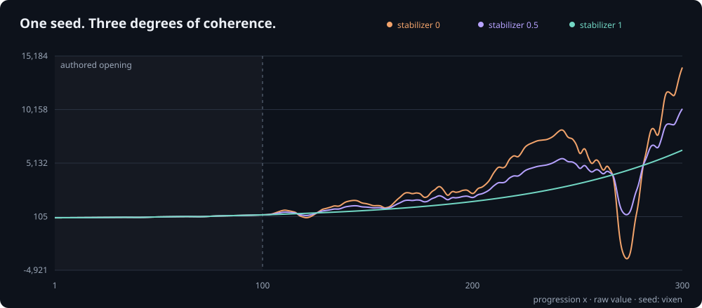

# Vixen

**A seeded landscape with teeth.** A small JavaScript/Python library for progression curves that start gently, become irregular, and can settle onto a trajectory without losing their identity.



## Why this exists

Sometimes a plain exponential is too predictable, independent random rolls are too jumpy, and adding a sine wave just gives every seed the same hidden metronome.

Vixen started with a deliberately specific brief: keep progression 1–100 recognizable, with two authored dips; after 100, allow surprising climbs, valleys and negative excursions, but make the transitions continuous. Then make the shape reproducible, navigable within a seed, and controllably calmer.

It is **one opinionated construction**, not a universal procedural-generation framework. Its useful combination is:

- an exact authored opening;
- irregular, counter-addressed seeded variation afterward;
- a continuous 16-dimensional coordinate space to explore within one seed;
- a trajectory stabilizer, distinct from simply turning down amplitude;
- stateless, random-access evaluation;
- both raw progression and bounded game-facing signals.

The seed chooses a landscape. Coordinates choose a place within it. Velocity chooses a route through it. Stabilization changes how closely the curve follows its own slow backbone.

## Where it might fit

These are possible integrations, not claims of production use or automatic game balance:

- **Encounter or difficulty modulation:** turn `activity` into a bounded spawn chance, intensity, or tuning factor. The [encounter example](examples/encounters.mjs) demonstrates the mapping; your game still makes the decisions.
- **Progression experiments:** compare a smooth authored backbone with more volatile continuations. Use raw `value` only when signed, rapidly growing numbers are appropriate.
- **Procedural families:** derive related curves from nearby coordinates without changing the seed. Useful for exploring world, region, or item profiles. Dimensions have no built-in semantic labels.
- **Visual or environmental controls:** sample smooth coordinate paths for lighting, camera, shader or other low-rate modulation. The [orbit example](examples/orbit.mjs) follows a closed path. This is not a band-limited audio generator.
- **Reproducible fixtures and stress cases:** revisit the same dips, peaks and excursions at arbitrary progression coordinates without replaying a simulation.

If you only need ordinary smooth noise, an exponential, a weighted random draw, or a fixed authored difficulty curve, use that simpler thing. Vixen earns its place when this particular combination is useful.

## Try it before integrating it

Open [instrument/vixen.html](instrument/vixen.html) directly in a browser. No server or installation is needed.

1. Leave stabilization at **0**, then drag the coordinate map.
2. Rotate the exploration plane. Your selected curve stays put; the directions you can explore change.
3. Add **Travel** to move through the landscape as progression advances.
4. Try stabilization **0.5**, **0.85**, and **1**. The cyan backbone shows what the curve is approaching.
5. Change the seed to choose another landscape. Export configuration and CSV when you find something useful.

The first hundred stays unchanged. Full stabilization remains gently variable and positive, not necessarily strictly monotonic.

## Drop it into a project

### JavaScript / TypeScript

With authenticated access to this currently private repository:

```sh
npm install git+https://github.com/worflor/vixen.git
```

```js
import {create} from '@worflor/vixen';

const curve = create({seed: 'my-world', stabilizer: 0.85});
const {activity, positiveMultiplier} = curve.sample(300);
```

Or vendor [vixen.mjs](vixen.mjs). [TypeScript declarations](vixen.d.ts) are included. ESM, Node 20+, or modern browsers; no runtime dependencies.

### Python

```sh
python -m pip install "vixen-curves @ git+https://github.com/worflor/vixen.git"
```

```python
from vixen import Vixen

curve = Vixen(seed="my-world", stabilizer=0.85)
activity = curve.sample(300)["activity"]
```

Or vendor [vixen.py](vixen.py). Python 3.10+; standard library only. Neither implementation needs an AI model, Scryer connection, API key, server, or Whisperglass installation at runtime.

### Choose an output deliberately

- `activity`: bounded 0–1 control signal.
- `positiveMultiplier`: bounded positive tuning factor.
- `positiveValue`: authored growth multiplied by that positive factor.
- `value`: raw signed progression; can go negative before full stabilization and becomes enormous at high progression.

See [the API reference](docs/reference/API.md) for configuration domains and the complete sample. Reward rounding, caps, authorization and anti-cheat belong in the host project.

## Give the curve rules

```js
const bounded = create({
  seed: "my-world",
  floor: "backbone",       // none | zero | baseline | backbone
  ceilingMargin: 0.35,      // null disables; margin is in baseline units
  boundarySoftness: 0.1,    // 0 is hard clipping; positive uses C2 joins
  stabilizer: 0.3
});
```

Zero floor prevents negative raw values. Baseline/backbone floors prevent undercutting that reference. The optional ceiling is above the backbone, or above baseline when that floor is selected. Softness changes the transition width, not the limits. A zero-margin trajectory band deliberately collapses to its reference. Boundaries and stabilization are separate controls.

`value` and game adapters describe the constrained signal. `unconstrainedValue` preserves the source for inspection. Inside a soft buffer, admissible values may be reshaped; outside it the mapping is identity. [Boundary semantics and evidence](docs/reference/CONSTRAINTS.md).

Run `node examples/constraints.mjs`, or use the instrument's Allowed range panel.

## Tinker

```sh
git clone https://github.com/worflor/vixen.git
cd vixen
npm ci
node examples/basic.mjs
node examples/encounters.mjs
node examples/orbit.mjs
node examples/sweep.mjs my-world 0.85 300 0.25 > samples.csv
```

The sweep's seed argument is **text**, even when it looks numeric. The API separately accepts numeric uint32 seeds. Play with seed, latent coordinates, velocity, strength, tempo, contrast and stabilizer before editing the construction itself.

Save the **algorithm and full configuration**, not only the seed:

```js
import {restore} from '@worflor/vixen';
const snapshot = {algorithm: curve.algorithm, config: curve.config};
const replay = restore(JSON.parse(JSON.stringify(snapshot)));
```

Prior hyperfield `/1` snapshots restore explicitly with stabilization zero. Other old algorithms require their matching [archived sampler](legacy/). Hashes match across the two languages; floating curves use tolerances, not cross-platform bitwise guarantees.

## Where Scryer fits

Scryer helped derive and check the exact mathematical components: the quintic joining function, its range and derivative bounds, a nonnegative complement witness, and signs used in the baseline-positivity argument. Those constraints matter because they make the sampler's joins and conservative bounds explainable, not just visually appealing.

The [construction notes](docs/reference/CONSTRUCTION.md) walk through the mechanism and point to the recorded evidence. This is a demonstration of exact mathematics supporting an executable instrument. It is **not** a whole-program proof, proof of dynamical chaos, or guarantee that every seed looks good.

## Work on it

```sh
npm test
npm run typecheck
python tests/cross_port.py
python tools/build_instrument.py
```

- [Technical design](docs/TDD.md): implementation, invariants, compatibility and verification.
- [Research design](docs/RDD.md): intent, observations, uncertainties and experimental taste.
- [AGENTS.md](AGENTS.md): repository map and contributor orientation.
- [Status](docs/STATUS.md): known limitations and release decisions.

Private for now, all rights reserved. No public redistribution license has been granted. The package is marked `private: true` to prevent accidental npm-registry publication; authenticated Git installation and local tarballs still work.
