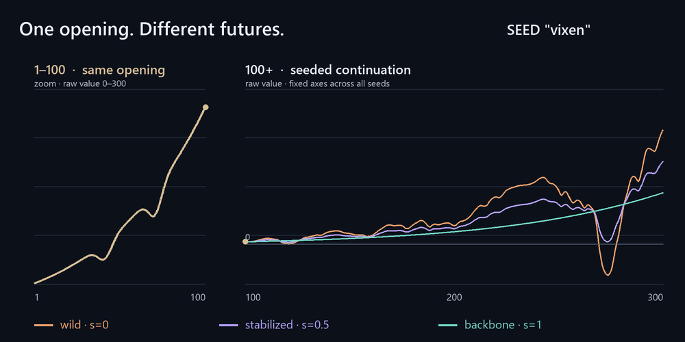

# Vixen

**A seeded landscape with teeth.** A deterministic, navigable family of smooth trajectories with history-preserving branches and authored function guides. JavaScript and Python; no runtime dependencies.



## What it is

Vixen evaluates one scalar value from a progression coordinate and a location in sixteen-dimensional space. A seed selects the field. A fixed location or a moving path through that field selects a trajectory. Evaluation is random-access: sampling order does not consume or change a random-number stream.

The object composes distinct ingredients:

- **Progression:** a positive authored baseline with configurable timing and two opening dips.
- **Variation:** counter-addressed noise averaged across seeded ridge directions, scales and phases.
- **Coherence:** stabilization toward the seed's broader, gentler backbone.
- **Admissibility:** optional floors, ceilings and smooth boundary transitions.
- **History:** immutable forks with exact inherited prefixes and deterministic future seeds.
- **Direction:** external polynomial, Taylor, derivative-jet or captured-function guides.

The dimensions are continuous controls, not independent outputs or predefined semantic labels. Vixen is a procedural trajectory engine, not a physics simulator, an intelligent agent, cryptographic randomness or a proof of dynamical chaos.

## Explore the object

Download [the offline instrument](instrument/vixen.html) and open it in a browser. Adjust the seed and progression controls, navigate a coordinate slice, attach a function guide, inspect a position and fork the timeline. Export complete replay data, actual sampled CSV or self-contained JavaScript/Python SDK code.

Root controls lock after a fork or influence to protect history. Display controls remain available. Reset explicitly starts a new root. The README animation uses actual samples and fixed continuation axes; it cuts between seeds rather than interpolating hypothetical seeds.

## Install

Git installation requires access to this repository:

```sh
npm install git+https://github.com/worflor/vixen.git
python -m pip install "vixen-curves @ git+https://github.com/worflor/vixen.git"
```

```js
import {create, captureGuide, restore} from '@worflor/vixen';

const root = create({seed: 'my-world', stabilizer: 0.3});
const guide = captureGuide(x => 80*Math.sin(x/23) + .3*x,
  {domain: [100, 500], count: 129});
const guided = root.influence(guide,
  {at: 120, amount: 0.7, handoffWidth: 24});
const future = guided.fork({at: 180, operation: 'take-key'});
const replay = restore(JSON.parse(JSON.stringify(future.snapshot())));
const value = replay.sample(300).value;
```

```python
import json, math
from vixen import Vixen, capture_guide, restore

root = Vixen(seed='my-world', stabilizer=0.3)
guide = capture_guide(lambda x: 80*math.sin(x/23) + .3*x,
                      domain=[100, 500], count=129)
guided = root.influence(guide, at=120, amount=0.7, handoffWidth=24)
future = guided.fork(at=180, operation='take-key')
replay = restore(json.loads(json.dumps(future.snapshot())))
value = replay.sample(300)['value']
```

ESM/Node 20+ or modern browsers; Python 3.10+. No AI model, Scryer connection, server or viewer is required at runtime.

**Vendoring:** keep `vixen.mjs`, `vixen-guide.mjs` and `vixen-influence.mjs` together, plus `vixen.d.ts` for TypeScript. Python needs `vixen.py`, `vixen_guide.py` and `vixen_influence.py`. The instrument's SDK exports bundle those modules into a single file for each language.

## Choose a trajectory and output

- `sample(x)` follows the configured path.
- `at(x, coordinates)` reads the same field at an explicit sixteen-dimensional location.
- `location(x)` exposes the configured path position.
- `value` is the signed, constrained progression value; it can be negative or very large.
- `activity` is a bounded control signal in [0,1], not a calibrated probability.
- `positiveMultiplier` is a bounded positive tuning factor.
- `positiveValue` scales the positive authored baseline by that factor, not by the raw guide value.

Adapters derive from the actual constrained deviation. Unrestricted diagnostics and underlying-field inspection remain available. Read `domain` before sampling: progression timing and finite guide domains can reduce the upper limit.

## Shape without conflating controls

`openingEndpoint` rescales the authored clock. `introVariation` varies the two dip parameter sets; zero selects the fixed opening. `strength` controls native modulation amplitude, `contrast` its response, and `tempo` its spatial/progression scale.

**Stabilization** blends fine variation toward the seed's broad backbone. **Influence** pulls the unrestricted value toward a foreign scalar guide. They have different targets and separate controls. Full influence follows the stored guide after handoff wherever output policies permit it.

Guide inputs can directly represent finite polynomials and Taylor expansions, interpolate supplied value/slope/curvature jets, or capture a trusted developer callback. Capture creates a smooth approximation: it can miss behavior between knots, overshoot, and does not establish Taylor convergence or source-function fidelity. Snapshots contain numeric guide data, never executable callback source. [Guide contracts](docs/reference/GUIDES.md).

Floors are `none`, `zero`, `baseline` and `backbone`. The nullable ceiling margin uses baseline units. Softness controls the admissible boundary buffer, not permission to cross the limit. Hard clipping can introduce corners; a collapsed band deliberately removes variation. Stabilization is not a guarantee of strict monotonicity. [Boundary contracts](docs/reference/CONSTRAINTS.md).

## Preserve history and replay

Forks preserve the actual parent's samples and world coordinates through the decision point. Their smooth handoff matches value, slope and curvature wherever the participating curves are C2. Influences also preserve the parent prefix, and later forks retain their guides.

Operations are deterministic decision tokens, not interpreted physical commands. Finite seed hashes can collide, and full influence can make different seeds follow the same scalar curve. Narrow handoffs can be sharp even when smooth.

Save the complete `snapshot()`. Latest-leaf `config` alone cannot recover branches or nested guides. Integer hash/seed derivation matches exactly across ports; floating evaluation uses declared tolerances rather than cross-backend bitwise lockstep. [Timing and replay](docs/reference/TIMELINES.md), [conditioning](docs/reference/CONDITIONING.md).

## Applications and experiments

Use Vixen for reproducible control trajectories: encounter intensity, progression experiments, procedural environment parameters, families of related curves, guided modulation and stress fixtures. Explore coordinate paths, compare seeds under fixed axes, or mix authored envelopes with seed-specific variation.

Host projects own calibration, rewards, authorization and domain semantics. Smoothness is not band limitation; bounded activity is not fairness or a payout expectation.

Runnable examples: [basic sampling](examples/basic.mjs), [encounters](examples/encounters.mjs), [coordinate orbit](examples/orbit.mjs), [sweeps](examples/sweep.mjs), [constraints](examples/constraints.mjs), [timelines](examples/timelines.mjs), [guides](examples/guides.mjs) and [Python guides](examples/guides.py).

## Develop and verify

```sh
npm ci
npm test
npm run typecheck
python tools/verify.py
node tests/fuzz.mjs
python tools/mutation_probe.py
node tools/benchmark.mjs
python tools/build_instrument.py
node tests/browser.mjs
```

See [technical design](docs/TDD.md) for distribution checks, self-contained exports and media regeneration; [research design](docs/RDD.md) for measurement and evidence rules; [contributor map](AGENTS.md) for source ownership and invariants.

## Mathematical reference

- [Construction](docs/reference/CONSTRUCTION.md): field, progression and composition.
- [API](docs/reference/API.md): accepted inputs, outputs and replay schemas.
- [Function guides](docs/reference/GUIDES.md), [boundaries](docs/reference/CONSTRAINTS.md), [timelines](docs/reference/TIMELINES.md), [conditioning](docs/reference/CONDITIONING.md).
- [Limitations and release policy](docs/STATUS.md).

Exact component findings, replayed certificates, implementation regressions and sampled audits establish different kinds of evidence. Scryer is a derivation instrument, not a runtime dependency or a whole-program certificate. Historical observations remain separate from current API contracts.

Licensed under [MIT](LICENSE). Licensing, repository access and publication are independent controls; npm-registry publication is disabled by `private: true`.
